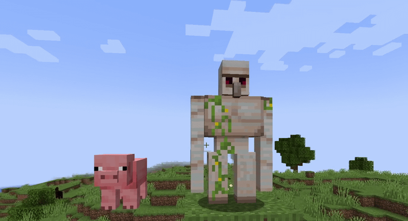

# **Indicate**
Informational Utility Mod that add Damage Indicators to Minecraft, they will pop up when anything living takes damage



---
# **Tech Documentation**

No dependency way to show generic popups like `MISS`, `CRIT`, `DODGE` and adding damage indicators for compatibility reasons.

```java
target.getPersistentData().putBoolean("indicate:miss", true);
                
target.getPersistentData().putBoolean("indicate:dodge", true);
                
target.getPersistentData().putBoolean("indicate:crit", true);
```

The data file for damage indicator should be stored at `resources/assets/<mod_id>/damage_indicators`
```json
{
  // Required: single damage type, #tag, or an array of both:
  // "damage_type": "modid:damage_type",
  // "damage_type": "#modid:damage_type_tag",
  "damage_type": [
    "#minecraft:is_fall",
    "minecraft:fly_into_wall",
    "minecraft:stalagmite"
  ],
  
  // Optional hex colors (# is optional), defaults: "b31111" / "000000"
  "color_hex": "d6c5a3",
  "outline_color_hex": "241e14",
  
  // Optional prefix glyph before the damage number (Example: ☠ 12.5)
  "glyph": "\uE278",
  // Optional font location for the glyph (default: minecraft:default)
  "font": "modid:font_location",
  
  // Optional priority (default: 0). Higher value will override over generic presets (e.g. projectiles use -10)
  "priority": -10
}
```

### API

```java
IndicateAPI.miss(LivingEntity target);

IndicateAPI.dodge(LivingEntity target);

IndicateAPI.popup(LivingEntity target, Component label);

IndicateAPI.popup(LivingEntity target, Component label, int rgb);

IndicateAPI.popup(LivingEntity target, Component label, int rgb, int outlineRgb);

IndicateAPI.popup(LivingEntity target, Component label, Col color);

```